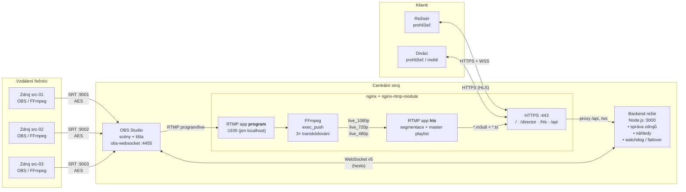
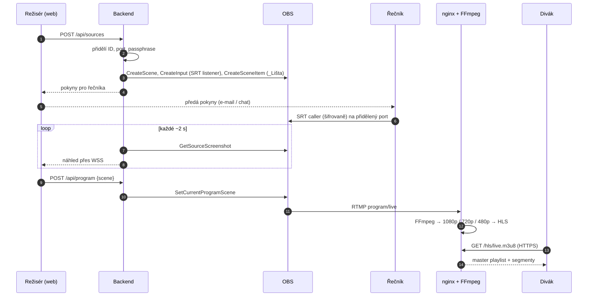
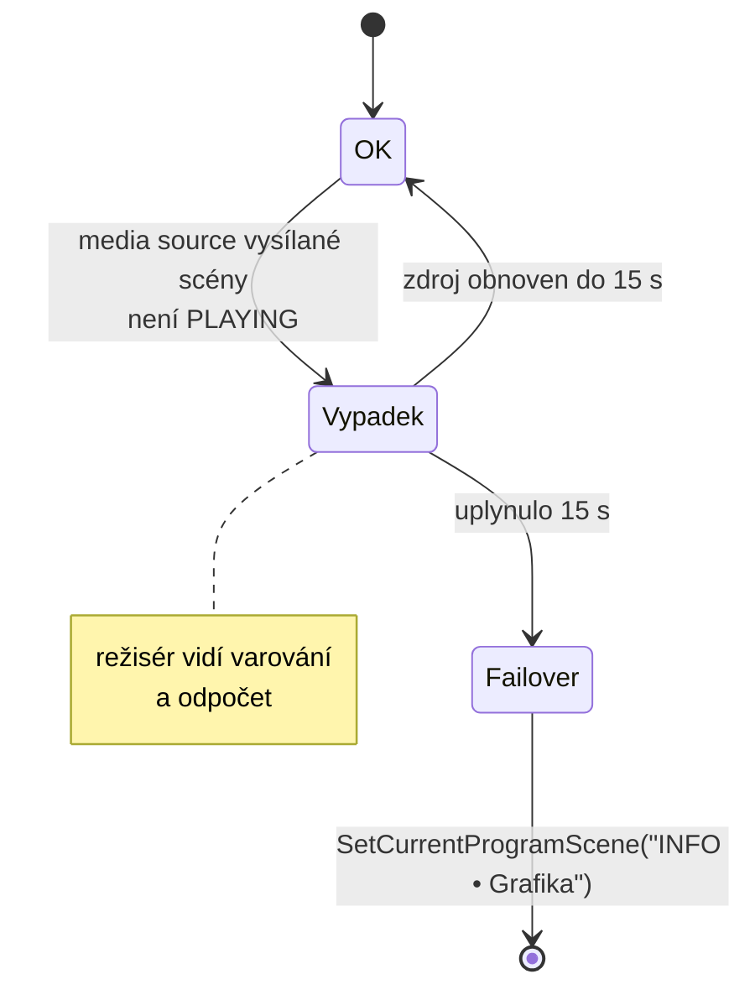

# MDS Live Studio

**Platforma pro živé internetové vysílání se vzdálenými obrazovými zdroji**

Projekt předmětu **Multimediální služby (MDS) 2026/27**.

Vzdálení řečníci posílají obraz a zvuk šifrovaně přes **SRT**. Centrální **OBS Studio** z nich skládá program a **režisér** ho řídí z prohlížeče, takže OBS nemusí vůbec ovládat. Hotový program putuje přes **RTMP** do **nginx**. **FFmpeg** ho převede do tří kvalit a diváci ho sledují jako adaptivní **HLS** stream na responzivní webové stránce.

```
 Řečníci (OBS / FFmpeg) ──SRT──▶ Centrální OBS ──RTMP──▶ nginx + FFmpeg ──HLS──▶ Diváci
                                      ▲
                                      │ obs-websocket
                              Režisérská aplikace (web)
```

---


## Funkce

| Oblast | Funkce |
|---|---|
| **Příjem zdrojů** | Současně ≥ 3 nezávislí vzdálení řečníci přes SRT. Každý má unikátní ID, vlastní port a vlastní šifrovací klíč (AES). |
| **Zpracování v OBS** | Scéna pro každý zdroj, statická scéna s informační grafikou a společná textová lišta ve všech scénách. |
| **Režisérské rozhraní** | Seznam zdrojů, živé náhledy, přepínání scén a informace o tom, co je právě ve vysílání. Umí přidávat a mazat zdroje (scény), generovat pokyny pro řečníky a měnit text lišty. |
| **Distribuce** | RTMP do nginx, FFmpeg transkóduje do 3 kvalit (1080p / 720p / 480p) a nginx z nich udělá adaptivní HLS. |
| **Divácká stránka** | Video.js přehrávač s automatickým i ručním výběrem kvality. Je responzivní a dokud se nevysílá, ukazuje hlášku „čekáme na zahájení vysílání“. |
| **Failover** | Výpadek vysílaného zdroje se automaticky detekuje a zobrazí režisérovi. Když se zdroj do **15 s** neobnoví, program se sám přepne na informační grafiku, i když režisér nemá aplikaci otevřenou. |
| **Bezpečnost** | HTTPS (self-signed), heslem chráněné obs-websocket, šifrované SRT, RTMP publish povolený jen z localhostu. |

---

## 🏗 Architektura

### Celkový pohled



---

## Komponenty podrobně

### 1. Vzdálené zdroje (řečníci)

Řečník pošle obraz a zvuk z **OBS Studia** nebo **FFmpeg** jako SRT *caller* na přidělený port centrálního stroje.

- **ID zdroje** (`src-01`, `src-02`, …) se posílá jako `streamid` a v OBS i v režii identifikuje scénu.
- **Port** je pro každý zdroj vlastní (rozsah `9001–9010/UDP`).
- **Passphrase** je unikátní pro každého řečníka a zapíná AES šifrování (`pbkeylen=32` → AES-256).

### 2. Centrální OBS Studio

OBS je „střižna“. Každý vzdálený zdroj je v něm **Media Source** (`ffmpeg_source`) v režimu **SRT listener** na svém portu:

```
srt://0.0.0.0:9001?mode=listener&passphrase=<klíč>&pbkeylen=32&latency=200000
```

**Konvence pojmenování** (backend se na ni spoléhá, neměnit ručně):

| Objekt v OBS | Název | Popis |
|---|---|---|
| Scéna zdroje | `SRC • src-01` | Obsahuje media source + vnořenou lištu |
| Media source | `SRT • src-01` | SRT listener daného zdroje |
| Informační scéna | `INFO • Grafika` | Statická grafika (logo, „za chvíli pokračujeme“) + lišta. Cíl failoveru. |
| Lišta (vnořená scéna) | `_Lišta` | Pozadí + textový zdroj. Vložená do **všech** scén, takže změna textu se projeví všude naráz. |
| Text lišty | `Lišta • Text` | Text (FreeType 2 / GDI+), mění ho backend přes `SetInputSettings` |

**obs-websocket** (součást OBS ≥ 28) běží na `127.0.0.1:4455` s povinným heslem.

**Výstup:** *Nastavení → Stream → Vlastní…*
- Server: `rtmp://127.0.0.1:1935/program`
- Klíč streamu: `live`

### 3. nginx + nginx-rtmp-module

nginx hraje tři role:

1. **RTMP ingest (`application program`)** přijme program z OBS. Publish je povolený jen z `127.0.0.1` a přehrávání je zakázané.
2. **Transkódování (`exec_push`)** spustí FFmpeg, který z jednoho vstupu vyrobí 3 varianty a pošle je zpět do `application hls`.
3. **HLS + HTTPS (`application hls` + `http`)** segmentuje varianty, vytvoří master playlist a servíruje web.


**Výsledné HLS:**

```
https://<host>/hls/live.m3u8              ← master playlist (výběr kvality)
https://<host>/hls/live_1080p/index.m3u8
https://<host>/hls/live_720p/index.m3u8
https://<host>/hls/live_480p/index.m3u8
```

### 4. Backend režie (`backend/`)

Node.js server (Express + `obs-websocket-js` + `ws`), poslouchá jen na `127.0.0.1:3000` a ven ho vystavuje nginx.

| Modul | Zodpovědnost |
|---|---|
| `obs.js` | Trvalé spojení s obs-websocket, automatický reconnect, obal nad požadavky (`GetSceneList`, `SetCurrentProgramScene`, `CreateScene`, `RemoveScene`, `CreateInput`, `CreateSceneItem`, `SetInputSettings`, `GetSourceScreenshot`, `GetMediaInputStatus`) |
| `sources.js` | Registr zdrojů `{ id, port, passphrase, name }`. Přiděluje volný port, generuje kryptograficky náhodný klíč (`crypto.randomBytes`), ukládá do `data/sources.json`. Při přidání zdroje vytvoří v OBS scénu, SRT media source a vnoří `_Lišta`. Při mazání scénu odstraní. |
| `previews.js` | Periodicky stahuje `GetSourceScreenshot` (JPEG, šířka 320 px, ~1 snímek / 2 s na zdroj) a rozesílá je přes WebSocket. **Screenshoty dělá jen jednou centrálně**, ne pro každého připojeného režiséra zvlášť, takže OBS nezatěžují. |
| `watchdog.js` | Každou 1 s kontroluje stav media source aktuálně vysílané scény a řídí failover (viz níže). |
| `instructions.js` | Generuje pokyny pro řečníka: hotové SRT URL, nastavení pro OBS a příkaz pro FFmpeg. |
| `server.js` | REST API + WebSocket pro režisérské UI |

**API (shrnutí):**

| Metoda | Cesta | Co dělá |
|---|---|---|
| `GET` | `/api/state` | Scény, aktuální program, stav zdrojů, text lišty |
| `POST` | `/api/sources` | Vytvoří nový zdroj (ID, port, klíč) a jeho scénu v OBS |
| `DELETE` | `/api/sources/:id` | Smaže zdroj a jeho scénu |
| `GET` | `/api/sources/:id/instructions` | Pokyny pro řečníka (JSON / text) |
| `POST` | `/api/program` | `{ scene }` → přepne program |
| `PUT` | `/api/ticker` | `{ text }` → změní text lišty |
| `WS` | `/ws` | Push událostí: náhledy, změna scény, výpadek/obnova zdroje, odpočet failoveru |

### 5. Režisérská aplikace (`nginx/site/director/`)

Jednostránková aplikace (HTML5 + Bootstrap 5 + vanilla JS) na `https://<host>/director/`, chráněná HTTP Basic Auth v nginx.

- Mřížka karet zdrojů s průběžně obnovovanými náhledy a stavem (live / bez signálu)
- Zvýraznění scény, která je právě ve vysílání
- Tlačítko **+ Zdroj** založí zdroj a scénu a hned ukáže pokyny pro řečníka (s tlačítkem *Kopírovat*)
- Mazání zdroje (s potvrzením)
- Editace textu lišty
- Výrazné upozornění při výpadku s odpočtem do automatického přepnutí

### 6. Divácká stránka (`nginx/site/index.html`)

- **Video.js** s HLS (VHS), automatická ABR volba kvality a ruční výběr přes plugin `videojs-hls-quality-selector`
- Responzivní layout (Bootstrap 5), použitelný i na mobilu
- **Čekací režim:** stránka každé 3 s zkouší `HEAD /hls/live.m3u8`. Dokud vrací 404, zobrazuje se „⏳ Čekáme na zahájení vysílání“. Jakmile playlist existuje, přehrávač se dynamicky vytvoří a spustí. Když stream skončí, stránka se vrátí do čekacího režimu.

---

## Datové toky krok za krokem



---

## Detekce výpadku zdroje (failover)

Watchdog běží **v backendu**, takže funguje nezávisle na tom, jestli má někdo otevřenou režii.



**Jak se výpadek pozná:**
1. Watchdog každou sekundu zavolá `GetMediaInputStatus` pro SRT source aktuální programové scény. Za výpadek považuje stav jiný než `OBS_MEDIA_STATE_PLAYING` (`ENDED`, `STOPPED`, `ERROR`, …).
2. Navíc poslouchá událost `MediaInputPlaybackEnded`, aby zareagoval okamžitě.
3. Při výpadku pošle všem režisérům událost `source_down` s odpočtem.
4. Když se zdroj do 15 s vrátí, pošle `source_up` a nic se nepřepíná.
5. Jinak backend sám přepne program na `INFO • Grafika` a pošle událost `failover`.

> Media source v OBS má zapnuté *„Restartovat přehrávání, když se zdroj stane aktivní“* a krátký reconnect delay, aby se listener po odpojení řečníka hned znovu otevřel.

---

## Zabezpečení

| Vrstva | Opatření |
|---|---|
| **SRT** | Každý zdroj má vlastní port a vlastní náhodnou passphrase (AES-256, `pbkeylen=32`). Bez klíče se spojení nenaváže a data nejdou dešifrovat. |
| **obs-websocket** | Povinné heslo, poslouchá jen na `127.0.0.1`. Heslo zná jen backend (`.env`), nikdy prohlížeč. |
| **RTMP** | `allow publish 127.0.0.1` v obou aplikacích, `deny play all`, takže zvenku do nginx nikdo nepublikuje ani si nestáhne surový program. |
| **Web** | HTTPS se self-signed certifikátem, HTTP :80 jen přesměrovává na :443. |
| **Režie** | `/director/` a `/api` jsou za HTTP Basic Auth (`nginx/conf/.htpasswd`). Backend poslouchá jen na localhostu. |
| **Tajemství** | `.env`, `data/sources.json` a certifikáty jsou v `.gitignore`. V repu je jen `.env.example`. |

---

## Porty a adresy

| Port | Protokol | Služba | Dostupnost |
|---|---|---|---|
| `443` | TCP / HTTPS | nginx: web, HLS, proxy na backend | veřejně |
| `80` | TCP / HTTP | redirect na HTTPS | veřejně |
| `9001–9010` | **UDP** / SRT | listenery v OBS (1 port = 1 zdroj) | veřejně (pro řečníky) |
| `1935` | TCP / RTMP | nginx-rtmp (`program`, `hls`) | jen localhost |
| `4455` | TCP / WS | obs-websocket | jen localhost |
| `3000` | TCP / HTTP+WS | backend režie | jen localhost |

| URL | Co tam je |
|---|---|
| `https://<host>/` | Divácká stránka |
| `https://<host>/director/` | Režisérské rozhraní |
| `https://<host>/hls/live.m3u8` | Master HLS playlist |

---

## Tým a rozdělení práce

| Člen | Role | Hlavní části |
|---|---|---|
| Simon Veselý (vedoucí) | | |
| Jan Ručka | | |
| David Osička | | |
